# The Erdős–Simonovits degeneracy conjecture is false for all r ≥ 2

Fable 5, Opus 5 · Christian Lewis<sup>\*</sup> · August 1, 2026

<sub><sup>\*</sup>Evolving Programs, in partnership with High Signal.&nbsp;&nbsp;Last revised August 6, 2026.</sub>

## Introduction

The **extremal number** $\mathrm{ex}(n,H)$ is the largest number of edges in an
$n$-vertex graph that contains no copy of $H$.

<p align="center">
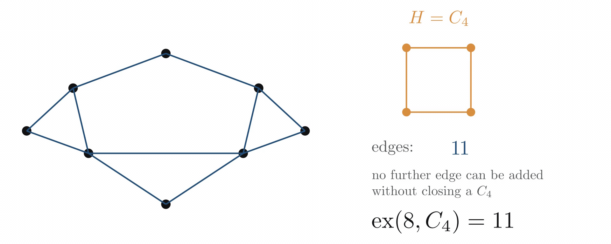
<br>
<sub><em>At n&nbsp;=&nbsp;8 with H the 4-cycle: 11 edges, no copy of H.</em></sub>
</p>

**Degeneracy** is one measure of how dense a graph is. A graph is $r$-degenerate
if its vertices can be deleted one at a time, in some order, so that each
deletion removes at most $r$ edges.

<p align="center">
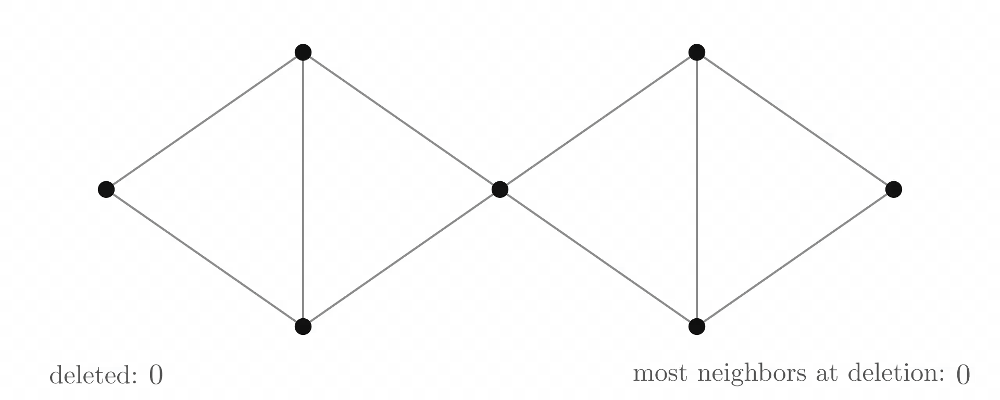
<br>
<sub><em>No vertex leaves with more than two neighbors, thus r&nbsp;=&nbsp;2.</em></sub>
</p>

A graph is **bipartite** if its vertices can be divided into two parts $U$ and
$V$, and every edge connects a vertex of $U$ to a vertex of $V$. A triangle is
not bipartite because an edge will inevitably form a $\{U, U\}$ or $\{V, V\}$
pair. Graphs are bipartite if they do not contain an odd cycle.

<p align="center">
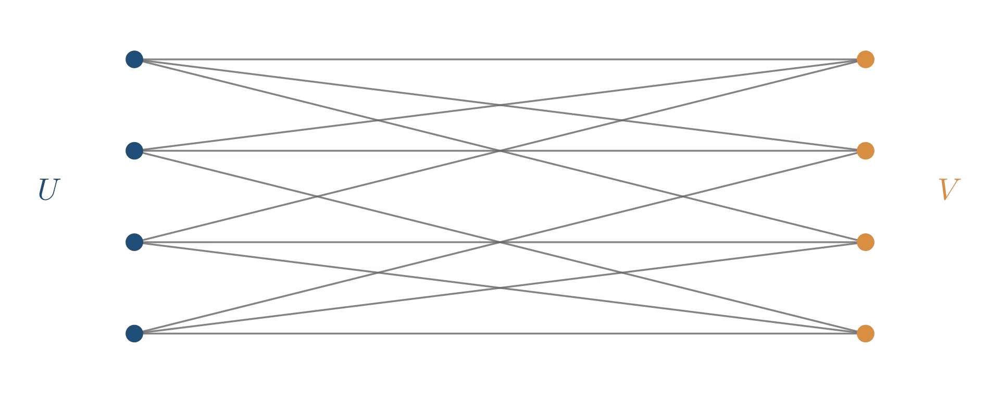
<br>
<sub><em>The vertices of a bipartite graph with 12 edges are sorted into two sides $U$ and $V$.</em></sub>
</p>

When $H$ is non-bipartite, $\mathrm{ex}(n,H)=\Theta(n^2)$, that is, its extremal
number is of order $n^2$ up to a constant factor. For bipartite $H$,
$\mathrm{ex}(n,H)=O(n^{2-\alpha})$ for some $\alpha>0$, that is, its extremal
number is at most of order $n^{2-\alpha}.$ Erdős and Simonovits proposed that
$\alpha=\frac1r.$

Because $\mathrm{ex}(n,H)$ is a maximum over $H$-free graphs, proving a lower
bound in excess of the conjectured $2-\frac1r$ requires demonstrating a single
graph that has more than $n^{2-1/r}$ edges without containing a copy of $H$. These
two criteria are in tension because having many edges is what forces copies of a
fixed subgraph to appear.

> **Result:** For all $r\ge2$, the tower $H_r$ built below has
$\mathrm{ex}(n,H_r)=\Omega(n^{2-1/r+\varepsilon})$ with
$\varepsilon\ge1/(28r^2)$; that is, its extremal number is at least of order
$n^{2-1/r+1/(28r^2)}$, in excess of the conjectured ceiling $n^{2-1/r}$.

The components below originate in OpenAI's result for $r=2$, Chapter 10 of
[*Ten advances in mathematics and theoretical computer
science*](https://github.com/openai/ten-proofs) (2026), cited below as [OAI26].

## Abstract

A graph is $r$-degenerate if every induced subgraph of it has minimum degree at
most $r$. Erdős and Simonovits conjectured that the Turán number (or extremal
number) of every bipartite $r$-degenerate graph $H$ satisfies

$$\mathrm{ex}(n,H)\ =\ O\big(n^{2-\frac{1}{r}}\big).$$

The case $r=2$ was refuted by OpenAI on the morning of August 1, 2026, via a
layered Hamming-ball construction. We generalize this method and prove that
the conjecture also fails for all $r$ beyond that.

For all $r \ge 2$, there exists a connected bipartite graph $H_r$ of degeneracy
**exactly** $r$, for which


$$\mathrm{ex}(n,H_r)\ =\ \Omega\big(n^{\,2-\frac{1}{r}+\varepsilon}\big),\qquad \varepsilon\ \ge\ \frac{1}{28r^2}.$$

<p align="center">
<sub>Verification: <a href="proofs/Theorem12.lean"><code>RDegenerateGraphsTarget.rDegenerateExtremalCounterexample_exact</code></a>; at r&nbsp;=&nbsp;3, <a href="proofs/Theorem12r3.lean"><code>ThreeDegenerateGraphsTarget.threeDegenerateExtremalCounterexample_sharp</code></a>.</sub>
</p>

We also determine that this window obeys an asymptotic law with a sharp phase
transition at Gibbs weight $e$, and the supremal constant of its exponent gain
is $1/(8r^2)$, approached but not attained. For every
$\delta \in (0,1)$ and every sufficiently large $r$ there is a connected
bipartite graph $H_{r,\delta}$ of degeneracy **exactly** $r$, for which


$$\mathrm{ex}(n,H_{r,\delta})\ =\ \Omega\big(n^{\,2-\frac{1}{r}+\varepsilon}\big),\qquad \varepsilon\ \ge\ \frac{1-\delta}{8r^2}.$$

<p align="center">
<sub>Verification: <a href="proofs/Corollary14.lean"><code>RDegenerateGraphsTarget.twoTierExtremalCounterexample</code></a>.</sub>
</p>

### The forbidden graph

The degeneracy conjecture is a claim about *every* bipartite $r$-degenerate
graph, so we are free to choose any qualifying $H$. The graph we forbid is the
layered subset tower $H_r$. Above a root layer $V_0$, each layer
$V_{i+1}=\binom{V_i}{r}$ consists of all $r$-element subsets of the previous
layer, and each subset (a *child*) is joined to its $r$ elements (its
*parents*). At $r=2$ this is exactly the layered graph of [OAI26].

At $r=2$, over the roots $a,b,c$,

$$V_1=\big\lbrace \lbrace a,b\rbrace,\lbrace a,c\rbrace,\lbrace b,c\rbrace \big\rbrace,\qquad V_2=\Big\lbrace \big\lbrace \lbrace a,b\rbrace,\lbrace a,c\rbrace \big\rbrace,\ \big\lbrace \lbrace a,b\rbrace,\lbrace b,c\rbrace \big\rbrace,\ \big\lbrace \lbrace a,c\rbrace,\lbrace b,c\rbrace \big\rbrace \Big\rbrace .$$

Keeping only $\lbrace a,b\rbrace$ and $\lbrace b,c\rbrace$ in $V_1$ would also
leave a $2$-degenerate graph, but it would omit $\lbrace a,c\rbrace$ and
every combination containing it in later layers.

<p align="center">
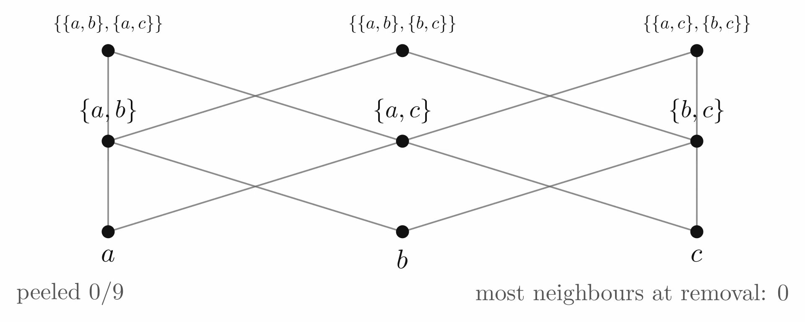
<br>
<sub><em>How H<sub>r</sub> is built, shown at r&nbsp;=&nbsp;2 with three roots: each layer consists of all 2-subsets of the layer below, and each child is joined to the two elements it contains. Peeled from the top, every vertex leaves with at most 2 neighbors.</em></sub>
</p>

<p align="center">
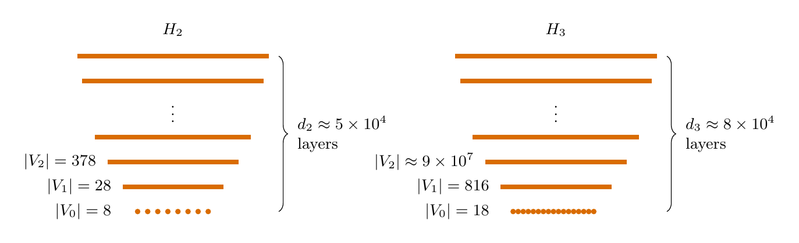
<br>
<sub><em>The counterexamples H<sub>2</sub> and H<sub>3</sub> in true shape, middle levels elided.</em></sub>
</p>

Peeling the layers from the top, each vertex at its removal has no remaining
neighbors other than its $r$ parents, so the degeneracy of $H_r$ is at most $r$.
The subgraph induced on the bottom two layers has minimum degree $r$, as each
child keeps its $r$ parents and each root is a parent of at least $r$ children,
so the degeneracy is at least $r$. The degeneracy of $H_r$ is therefore exactly
$r$. 

Our tower has depth $\Theta(r^2)$, while the tower of [OAI26] has constant
depth. Each layer of our tower moves the entropy potential by a fixed fraction of the
width of the [dense exclusion window](#the-dense-exclusion-window) below, and at general $r$
that window is only of order $1/r^2$ wide, so $\Theta(r^2)$ layers are needed to
reach a contradiction.

### The sparsified Hamming host

Take two copies of the cube $\{0,1\}^m$, join $x$ to $y$ across the copies
whenever their Hamming distance is at most $\tau m$, and retain each vertex
independently with probability $2^{-\beta m}$. We call this exponent $\beta$ the
**sparsity** of the host. This construction is the same as that of [OAI26].

<p align="center">
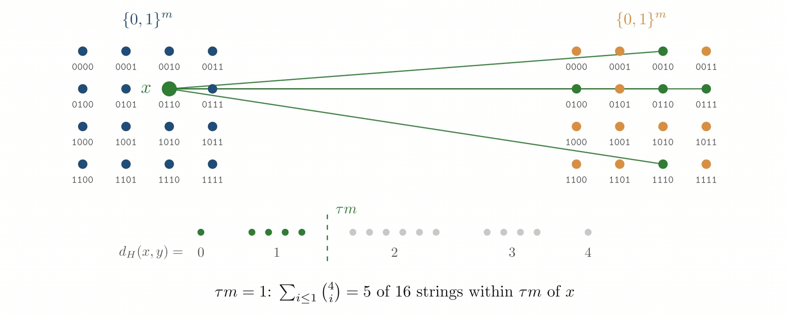
<br>
<sub><em>Two copies of {0,1}<sup>m</sup>, joined across Hamming distance at most τm, each vertex retained with probability 2<sup>−βm</sup>.</em></sub>
</p>

### The density threshold

A Hamming ball of radius $\tau m$ in $\{0,1\}^m$ holds $2^{h(\tau)m + o(m)}$
points. Here $h$ is the binary entropy function
$h(\tau) = -\tau\log_2\tau - (1-\tau)\log_2(1-\tau)$.

A second-moment argument shows that with high probability the retained graph
has $n \approx 2^{(1-\beta)m}$ vertices and $n^\gamma$ edges, where
$\gamma = \frac{1+h(\tau)-2\beta}{1-\beta}$. Because $\beta<1$, the requirement
$\gamma > 2-\frac1r$ can be rearranged as

$$\beta\ <\ C_r(\tau)\ :=\ r\,h(\tau)-(r-1).$$

<p align="center">
<sub>Verification: C<sub>r</sub> is <a href="proofs/lib/LawDefs.lean"><code>DegeneracyLaw.Cside</code></a>; the density claim it thresholds is Lemma 2.2, <a href="proofs/lib/SamplingR.lean"><code>proofs/lib/SamplingR.lean</code></a>.</sub>
</p>

We call this bound $C_r(\tau)$ the host's **density threshold**, as once $\beta$
exceeds it, the retained host no longer carries more than $n^{2-1/r}$ edges
(Lemma 2.2). At $r=2$, this is the threshold $2h(\tau)-1$ of [OAI26].

### The entropy ceiling

Suppose a copy of $H_r$ survives, and let $X_v$ denote the string at vertex $v$.
Adjacency in this host implies Hamming distance at most $\tau m$, and so an
embedded copy of $H_r$ constrains each child's string to lie near the strings of
all $r$ of its parents.

The per-bit conditional entropy of a uniformly random child $w$ of one layer,
given its parents $u_1,\dots,u_r$ in the layer below, is

$$\eta\ =\ \tfrac{1}{m}\sum_{j=1}^{m}\mathrm{H}\big(X_w^{(j)} \mid X_{u_1}^{(j)},\dots,X_{u_r}^{(j)}\big).$$

There is one term for each of the $m$ coordinates, measuring what the parents'
bits at that coordinate leave undetermined about the child's. A smaller $\tau$
confines the child to fewer strings once its parents are fixed, so the ceiling
on $\eta$ falls; a larger $\tau$ leaves more strings available, and so it
rises.


<p align="center">
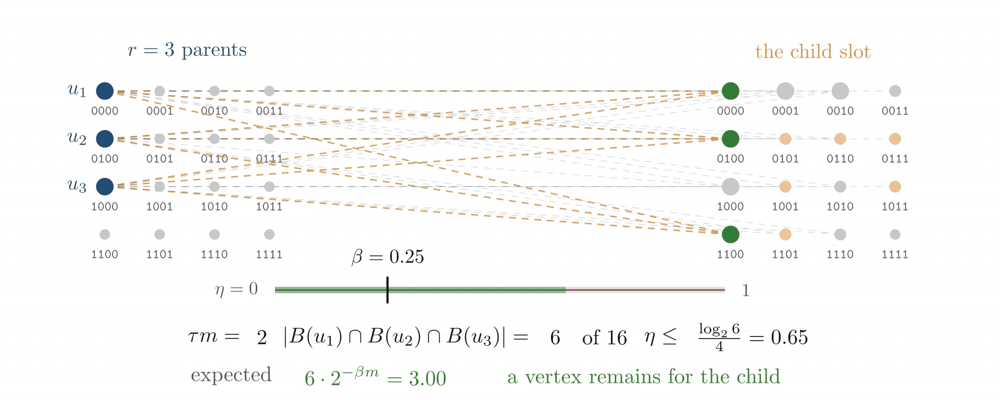
<br>
<sub><em>The collision at one child slot, drawn in full at m = 4. The three parents restrict the child to their common neighborhood, six of the sixteen strings at τm = 2, so η is at most (log<sub>2</sub> 6)/4 = 0.65. Raising β thins the host; when fewer than one of those six survives on average, the copy cannot be completed.</em></sub>
</p>

<p align="center">
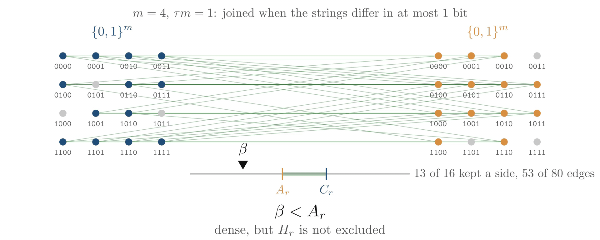
<br>
<sub><em>The whole host at m = 4 and τm = 1, shown at three settings of β (dropped vertices grey). Only in the middle region does the host asymptotically carry more edges than the conjecture permits while provably containing no copy of H<sub>r</sub>.</em></sub>
</p>


For the lower bound, the retained strings have density $2^{-\beta m}$. A child
restricted to fewer than $2^{\beta m}$ of them would expect to find none
retained, and therefore no vertex of the host to occupy. A first-moment count
rules out every such embedding, so in any surviving copy of $H_r$ this
conditional entropy satisfies $\eta > \beta$ (Lemma 3.1). 

For the upper bound, a child lies within $\tau m$ of each of its parents, so its
string is confined to the intersection of $r$ Hamming balls of radius $\tau m$.
Entropy is at most the log-volume of the set over which the variable ranges. A Gibbs soft-max estimate, applied one coordinate at a time, bounds that volume, penalizing each
disagreeing coordinate by the Gibbs weight $2^{\lambda}$, whose exponent
$\lambda>0$ is ours to choose. This caps the entropy at the **entropy ceiling**
$A_r(\lambda)$, up to a term that telescopes across layers, so a copy can
survive only if

$$\beta\ <\ A_r(\lambda)\ :=\ \lambda\tau+\sup\{\,G_r(q,v)\ :\ 0\le q,v\le 1\,\},$$

<p align="center">
<sub>Verification: A<sub>r</sub> is <a href="proofs/lib/LawDefs.lean"><code>DegeneracyLaw.Aside</code></a> and G<sub>r</sub> is <a href="proofs/lib/LawDefs.lean"><code>DegeneracyLaw.Gfun</code></a>.</sub>
</p>

where $G_r$ is the Gibbs objective at a single coordinate (Lemma 3.2).

Above $A_r$, the two bounds cannot both hold at a layer unless the potential
increases by a fixed fraction of the window width. The tower's $\Theta(r^2)$
layers therefore push it past the one bit it can hold. No copy of $H_r$ survives
(Proposition 3.3). 

This technique is that of [OAI26], with two changes: (1) the entropy inequality
is generalized from two parents to $r$, and (2) the Gibbs weight, which [OAI26]
fixes at $3$, is kept as a free parameter $2^\lambda$.

### The dense exclusion window

The two thresholds divide the sparsity axis into three regimes:

  1. Below $A_r$, the entropy argument no longer excludes $H_r$.

  2. Above $C_r$, the retained host is no denser than the conjecture permits. 

  3. Any $\beta$ in between, $A_r(\lambda) < \beta < C_r(\tau)$, therefore
  yields a host which excludes our particular $H_r$, of degeneracy exactly $r$,
  while carrying more edges than the conjecture permits for *any* graph of that
  degeneracy. 

This refutes the conjecture at level $r$ with exponent gain arbitrarily close to
$\varepsilon_r^{\max}(\beta) = \frac{C_r-\beta}{r(1-\beta)}$.

<p align="center">
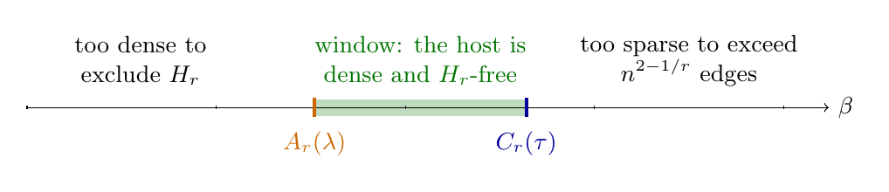
<br>
<sub><em>The two thresholds on the sparsity axis; any β between them refutes the conjecture at level r. Not drawn to scale.</em></sub>
</p>

Whether the window is nonempty is the point at which this work departs from
[OAI26]. At $r=2$, [OAI26] evaluates both thresholds at the single radius
$\tau=1/(1+\sqrt3)$ and exhibits a window of positive constant width in closed
form. 

At general $r$ no fixed radius succeeds: both thresholds lie at $1-\Theta(1/r)$,
so the radius must approach $\tau=\frac12$. The comparison therefore moves to
the lower-order terms, where each threshold has an explicit expansion. At $\tau=\frac12-\frac{c}{r}$, expanding $h$ about $\frac12$ puts the density
threshold below $1$ by an amount quadratic in the radius offset $c$:

$$C_r(\tau)\ =\ r\,h(\tau)-(r-1)\ =\ 1-\frac{2c^2}{\ln2}\cdot\frac1r-O\Bigl(\frac1{r^3}\Bigr).$$

<p align="center">
<sub>Verification: <a href="proofs/lib/WindowLowerBound.lean"><code>DegeneracyLaw.Lemma44.binaryEntropy_gap_bounds</code></a>, bracketing 1&nbsp;&minus;&nbsp;h(&frac12;&nbsp;&minus;&nbsp;x) between 2x²/ln2 and 2x²/ln2&nbsp;+&nbsp;3x⁴/ln2 for |x|&nbsp;&le;&nbsp;&frac14;.</sub>
</p>

For the entropy ceiling, a concavity argument (Lemmas 4.1 and 4.2), valid
whenever the Gibbs weight is subcritical, places the maximizer of the optimization defining $A_r$ at the center, where
the Gibbs soft-max over the $r$ parent bits collapses to a binomial
$\log\cosh$ average over $S_r = 2\,\mathrm{Bin}\bigl(r,\tfrac12\bigr)-r$, the
popcount fluctuation of $r$ fair parent bits:

$$A_r\ =\ \lambda\tau+1-\frac{\lambda}{2}+\mathbb{E}\,\log\cosh\Bigl(\frac{\lambda\ln2}{2r}\,S_r\Bigr).$$

<p align="center">
<sub>Verification: A<sub>r</sub> is <a href="proofs/lib/LawDefs.lean"><code>DegeneracyLaw.Aside</code></a>; its center value is <a href="proofs/lib/WindowUpperBound.lean"><code>DegeneracyLaw.Gfun_center_eq</code></a>, and <a href="proofs/Lemma42.lean"><code>DegeneracyLaw.Lemma42.supG_eq_center</code></a> shows the supremum is attained there.</sub>
</p>

Expanding the $\log\cosh$ term the same way, at second moment
$\mathbb{E}S_r^2=r$, the $1/r$ terms of the two thresholds combine into
$-(4c-\lambda\ln2)^2/(8\ln2)$, at most zero and zero only at
$c=\frac{\lambda\ln2}{4}$. That forces the tuned radius
$\tau_r=\frac12-\frac{\lambda\ln2}{4r}$, where the quadratic parts cancel
exactly. Now $\ln\cosh t$ lies below its parabola $t^2/2$ by
the quartic defect $t^4/12$, and $\mathbb{E}S_r^4=3r^2-2r$, so the ceiling
$A_r$ falls strictly below its quadratic approximation:

$$w_r\ :=\ C_r-A_r\ =\ \frac{\lambda^4\ln^32}{64\,r^2}\Bigl(1+O(\tfrac1r)\Bigr)\ >\ 0.$$

<p align="center">
<sub>Verification: positivity for every r&nbsp;&ge;&nbsp;2 at &lambda;&nbsp;=&nbsp;27/20 is <a href="proofs/lib/AssemblyR.lean"><code>DegeneracyLaw.width_pos_all</code></a>, on <a href="proofs/Lemma44.lean"><code>DegeneracyLaw.Lemma44.width_ge</code></a>; the asymptotic form is Theorem 1.3(a), <a href="proofs/Theorem13a.lean"><code>DegeneracyLaw.width_tendsto_unconditional_full</code></a>.</sub>
</p>

That defect, of order $1/r^2$, is the exponent gain.

<p align="center">
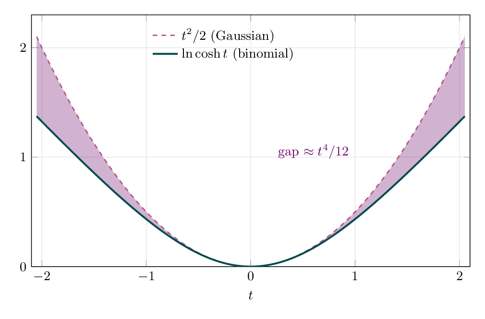
<br>
<sub><em>ln cosh t lies below its parabola t<sup>2</sup>/2, by t<sup>4</sup>/12.</em></sub>
</p>

Take $\beta$ just inside the exclusion edge $A_r$, which is the optimal end of
the window by Theorem 1.3(b). Together with the bound $w_r \ge 0.00603/r^2$ of
Lemma 4.4, certified in exact rational arithmetic at $\lambda=\frac{27}{20}$
for every $r\ge2$, this yields the $1/(28r^2)$ of Theorem 1.2; the
specialization $w_3 \ge 0.0098/9$ gives the gain $1/160$ at $r=3$.

Letting $\lambda$ vary instead determines the limits of the method. Below the
critical weight $2^\lambda=e$ the rescaled width converges,
$r^2 w_r \to \lambda^4\ln^32/64$, while above it $r^2 w_r \to -\infty$
(Theorem 1.3(a)). Theorem 1.3(b) determines the certified gain across the
window; it is largest at the exclusion edge, where it approaches the supremum
$1/(8r^2)$. The schedule $\lambda_r = \frac{1-(\ln r)/r}{\ln 2}$ is subcritical
for every $r$ and critical in the limit, and for any fixed $\delta$ it recovers the
ceiling up to a factor $1-\delta$ (Corollary 1.4).

The window is nonempty for every $r\ge2$, so some $\beta$ leaves the host
denser than the conjecture allows while still excluding $H_r$. The exponent is
therefore at least $2-\frac1r+\frac{1}{28r^2}$, and by this method never more
than $2-\frac1r+\frac{1}{8r^2}$.

<p align="center">
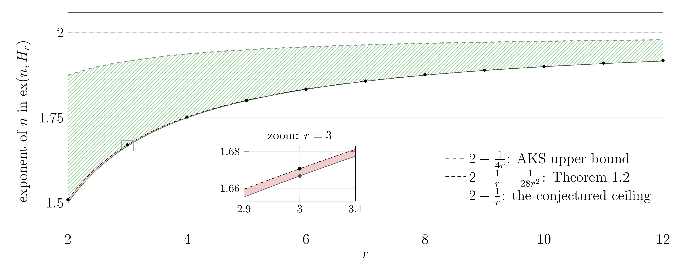
<br>
<sub><em>Bounds on the exponent of n in ex(n, H<sub>r</sub>).</em></sub>
</p>

## Verification

Every theorem in the paper is machine-checked in Lean 4 (toolchain `v4.32.0`)
over mathlib, sorry-free, with axioms `propext`, `Classical.choice`,
`Quot.sound`.

| Paper statement           | Lean declaration                                                          | File                                     |
|---------------------------|---------------------------------------------------------------------------|------------------------------------------|
| Theorem 1.2, general $r$  | `RDegenerateGraphsTarget.rDegenerateExtremalCounterexample_exact`          | [`proofs/Theorem12.lean`](proofs/Theorem12.lean)       |
| Theorem 1.2, $r=3$        | `ThreeDegenerateGraphsTarget.threeDegenerateExtremalCounterexample_sharp`  | [`proofs/Theorem12r3.lean`](proofs/Theorem12r3.lean)   |
| Theorem 1.3(a)            | `DegeneracyLaw.width_tendsto_unconditional_full`                           | [`proofs/Theorem13a.lean`](proofs/Theorem13a.lean)     |
| Theorem 1.3(a), sharpness | `DegeneracyLawSuper.threshold_sharp`                                       | [`proofs/lib/WindowSharp.lean`](proofs/lib/WindowSharp.lean)   |
| Theorem 1.3(b)            | `DegeneracyLawB.eight_rsq_epsMax_theta_tendsto`                            | [`proofs/Theorem13b.lean`](proofs/Theorem13b.lean)     |
| Corollary 1.4             | `RDegenerateGraphsTarget.twoTierExtremalCounterexample`                    | [`proofs/Corollary14.lean`](proofs/Corollary14.lean)   |

"Degeneracy exactly $r$" is carried literally as
`IsDegenerate r H ∧ ¬ IsDegenerate (r-1) H`, and the exponents appear as
written.

- Build: `lake exe cache get && lake build` (toolchain pinned by
  `lean-toolchain`). The default targets are sorry-free; the declaration
  inventory is [`formalization.yaml`](formalization.yaml). CI builds on pushes
  to `main` and pull requests, audits the two main
  counterexample theorems with `#print axioms`, then runs Comparator in the
  same workspace to reuse the built modules. Verification logs are uploaded
  as the `proof-verification` artifact.
- Challenges: each theorem is frozen as a standalone
  [Comparator](https://github.com/leanprover/comparator) statement in
  [`challenges/`](challenges/) (each ends in an intentional `sorry`) and
  discharged verbatim by the corresponding `Solution*.lean`:
  `for c in challenges/challenge*.json; do lake env comparator $c; done`.
  Challenge 5 additionally checks exact degeneracy at $r=3$ and the sharp
  $1/160$ gain. Human review includes reading the five challenge statements
  ([`challenges/NOTES_FOR_REVIEWER.md`](challenges/NOTES_FOR_REVIEWER.md)).
- Independent numerics: `python3 tests/numerics_check.py` re-computes the
  window, ledger, and degeneracy claims outside Lean.

## Instantiated towers

At $\lambda=\frac{27}{20}$ every parameter of the construction is a closed form
in $r$, and the layer rule is fixed, so each $H_r$ is determined by two numbers:
its root count $|V_0|$ and its depth. The depth is
$\lceil 100/\mathrm{width}_r\rceil+1$, and the root count is the least $N$
clearing the first-moment count of `exists_free_dense_hosts`,

$$N + (r+1)\log_2\Big(\tbinom{N}{r}+1\Big)\ <\ \delta_r\tbinom{N}{r}-1,
\qquad \delta_r=\mathrm{width}_r/400.$$

The $2r^2$ of the Lean statement is a floor on $|V_0|$, and it binds only from
$r \ge 7$.

| $r$ | $\lvert V_0\rvert$ | depth | first layer sizes |
|----:|------:|-------:|------------------|
| 2 | 402,835 | 50,342 | 402,835; $\sim\!10^{11}$; $\sim\!10^{22}$; $\sim\!10^{43}$ |
| 3 | 1,472 | 83,408 | 1,472; 530,501,440; $\sim\!10^{25}$; $\sim\!10^{75}$ |
| 4 | 269 | 130,269 | 269; 213,338,251; $\sim\!10^{32}$; $\sim\!10^{126}$ |
| 5 | 124 | 189,255 | 124; 225,150,024; $\sim\!10^{40}$; $\sim\!10^{196}$ |
| 6 | 80 | 260,035 | 80; 300,500,200; $\sim\!10^{48}$; $\sim\!10^{285}$ |

Sizes iterate $N_{i+1}=\binom{N_i}{r}$, so $\log|V(H_r)|$ grows by a factor
of $r$ per layer: $|V(H_r)|$ is about $N_0^{\,r^{d_r}}$, a number with roughly
$r^{d_r}$ digits. The four sizes listed are the first of tens of thousands, and
no enumeration of $H_r$ is possible.

[`scripts/certificates.py`](scripts/certificates.py) computes the table
together with $\tau_r$, both thresholds, $\beta_r$ and $\varepsilon_r$ for
$r \le 12$, writing `certificates.json`. The window is positive at every level,
and the per-$r$ exponent constant is $1/(21r^2)$ at $r=2$, improving with $r$
toward the $1/(8r^2)$ ceiling; $1/(28r^2)$ is the cost of a single constant for
all $r$. [`scripts/towers.py`](scripts/towers.py) writes four-layer truncations
of the layer rule to `artifacts/towers/`, each one peeled and its degeneracy
checked equal to $r$.

## Layout

All Lean sources live under [`proofs/`](proofs/):

- `proofs/` itself holds the named results, each in the file named after it.
- [`proofs/lib/`](proofs/lib/) holds the machinery: host and sampling, the
  entropy kernel and the exclusion argument, the analytic lemmas of Section 4
  behind the window, the ledger and its asymptotics, and the two-tier
  schedule. `proofs/lib/CompactnessAndDegeneracy.lean` is OpenAI's published
  $r=2$ file, vendored verbatim (Apache-2.0; see [`NOTICE`](NOTICE)).
- [`proofs/scratch/`](proofs/scratch/) holds a second, independent route to
  the $r=3$ case, built from hand-certified numerics and importing none of the
  general-$r$ analytic machinery. It reaches the weaker gain $1/4000$; the
  headline $1/160$ comes from the general pipeline. It is kept precisely
  because it is independent, so the $r=3$ result does not rest on a single
  chain.

Tests are in `tests/` and the frozen Comparator statements in `challenges/`.

## Acknowledgments

We thank OpenAI for publishing their work and providing the framework used
here. We also thank Sai Gajjala [@publishiperishi](https://x.com/publishiperishi)
of New York University for contributing to the Lean formalization, and Elliot
Glazer [@ElliotGlazer](https://x.com/ElliotGlazer) of Principia Labs for notes
on the Lean development and Comparator setup.

## Citation

Cite as: Fable 5, *The Erdős–Simonovits degeneracy conjecture is false for all r ≥ 2*, 2026.

```bibtex
@misc{fable2026degenerate,
  author = {{Fable 5}},
  title  = {The {E}rd\H{o}s--{S}imonovits degeneracy conjecture is false for all $r \ge 2$},
  year   = {2026},
  url    = {https://github.com/EvolvingPrograms/erdos-simonovits-degeneracy}
}
```

## Remarks

- The constants are not optimal: interval evaluation of the window at each
  fixed small $r$ would push $1/(28r^2)$ toward $1/(21r^2)$ and
  $\varepsilon_3$ toward $1/138$.
- The towers $H_r$ are enormous; the smallest bipartite $r$-degenerate graph
  violating the conjectured exponent is an open problem, already at $r=2$.
- The gap to the $O(n^{2-1/(4r)})$ upper bound of Alon–Krivelevich–Sudakov is
  of order $1/r$; closing it requires a construction outside this method's
  $1/(8r^2)$ ceiling.
